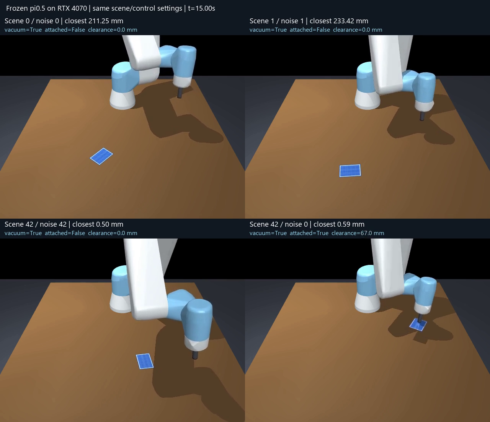

# Results and limitations

The latest measurements are development experiments from **16 October 2026**. The minimum pipeline runs on the GPU, but none of 14 controlled episodes met the full pickup criterion. These examples are not a held-out success-rate estimate.

## Rendering-consistent baseline

All three episodes use the same experimental `suction_upright` adapter, Intel Arc Pro OpenGL renderer and frozen RTX 4070 policy inference. Each lasts 20 simulated seconds.

| Scene / sampling seed | Closest TCP-to-card surface | Physical contact | Attachments | Full pickup criterion |
| --- | ---: | ---: | ---: | --- |
| 0 / 0 | 211.246 mm | 0 s | 0 | Failed |
| 1 / 1 | 233.422 mm | 0 s | 0 | Failed |
| 42 / 42 | 0.498 mm | 0.874 s | 0 | Failed |

Source: [controlled baseline measurements](evidence/controlled-baseline.json).

## Watch the controlled comparison

[Open the 20-second comparison video](media/seed-comparison.mp4).

The panels show scene/noise 0/0, 1/1, 42/42 and 42/0. The final combination forms valid attachments and briefly lifts the card about 67 mm; continuous attached clearance above 50 mm lasts only 0.222 seconds. Success requires two seconds. There is no auxiliary centering, vacuum latch or scripted lift.

The video contains 400 frames at 20 fps: [video verification](evidence/video-verification.json).

## What explains the contrast

- **A real startup regression changed the renderer.** Loading Torch before the first GL context selected a different graphics adapter and changed RGB inputs. The batch runner now initializes graphics first. Seeds 0/1 still miss after that fix.
- **Scene and sampling are separate factors.** Previously one seed changed both card placement and policy noise. Fixed-scene and fixed-noise experiments show substantial sensitivity to each.
- **No seed-specific control branch was found.** Model arrays, cameras, initial robot joints and controller settings match across the audited seeds. However, the earlier adapter development used seed 42, so this does not establish generalization.
- **The adapter matters.** Removing the upright guard and extra Cartesian clipping together made scene/noise 42 miss, without rescuing scenes 0/1. Four additional scene seeds also failed the pickup criterion.
- **Backend numerics remain a limitation.** The original JAX and converted CUDA implementations are not uniformly within the declared fixed-input tolerance.

All planned comparisons and failures are retained in the [adapter audit](evidence/adapter-audit.json) and [predeclared plan](evidence/adapter-audit-plan.json). The [full seed audit](archive/seed-audit.md) explains the controls, confounded early comparisons and remaining uncertainty.

## Numerical validation

These checks use identical saved initial observations and Gaussian flow noise; they are not whole-episode equivalence tests.

| Scene / noise seed | Full-chunk relative L2 difference | Maximum XYZ difference before adapter bounds | Declared tolerance |
| --- | ---: | ---: | --- |
| 0 / 0 | 43.065% | 1.537 mm | Failed |
| 1 / 1 | 0.728% | 0.534 mm | Passed |
| 42 / 42 | 0.457% | 0.230 mm | Passed |

The relative error is normalized by the saved CUDA output. Seed 0's largest discrepancy is a gripper prediction at action index 5, which is discarded when replanning after five commands. The executed prefix has matching gripper signs and up to 1.164 mm XYZ difference. That discarded prediction does not explain the recorded miss by itself.

Float32 attention logits reduced one input's error without consistently improving all three. The change remains diagnostic-only. Sources: [CPU/CUDA comparison](evidence/policy-parity.json), [attention ablation](evidence/attention-numerics.json).

## Scope of the evidence

All 5,600 commands in the 14 controlled episodes match their saved neural outputs at the adapter input, and vacuum commands match the raw gripper sign. Every model parameter is on CUDA; each episode has 400 recorded frames and 10,000 physics steps. See [episode verification](evidence/episode-verification.json).

The weights were frozen, with no training or card-pose targeting. The model was trained for another robot/gripper setting; transfer to UR7e suction and this card scene remains experimental. Suction physics use a rigid card and finite conditional weld. Physical deployment, decks, flexible cards, foundation-model orchestration and a formal held-out evaluation remain unfinished.

The earlier [hybrid experiments](archive/hybrid-control.md) achieved pickups with an RGB helper and scripted completion. Those components were removed, so their successes are not evidence of the current policy's competence.
